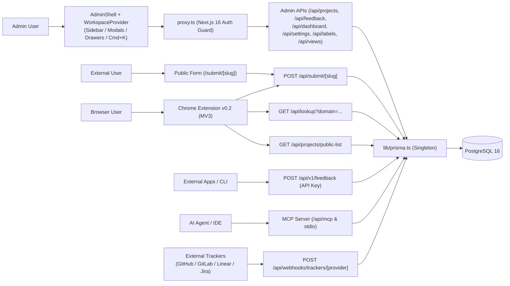
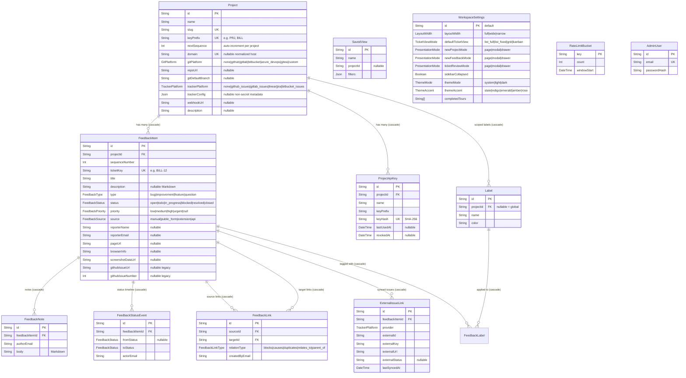

# Bug Tracking App — Knowledge Base

> **Current Version:** `v0.2.0` — **Workbench Platform** (defined in [`lib/version.ts`](../lib/version.ts) and [`package.json`](../package.json))
> **Related Docs:** [User & Operations Wiki](./WIKI.md) · [Readiness & Roadmap](./ROADMAP.md) · In-app guide at `/guide`

## 1. Overview & Evolution

**Bug Tracking** is a self-hosted, Linear/Jira-inspired multi-project bug tracking & triage workbench designed to keep quick bug reporting effortless across private repositories, public submission links, programmatic APIs, AI coding assistants (MCP), and a Chrome Manifest V3 browser extension.

### Release & Milestone History

| Milestone / Phase | Scope | Status |
| :--- | :--- | :--- |
| **Phases 1–5 (MVP)** | Projects CRUD, FeedbackItem CRUD, public `/submit/[slug]` form, Auth.js v5 single-admin login, Chrome MV3 extension with domain auto-lookup | Done (`v0.1.0`) |
| **M0: Hardening & Ops** | `Dockerfile` (standalone), full `docker-compose.yml`, `/api/health`, `requireAdminSession()` defense-in-depth, Vitest test suite | Done (`v0.1.0`) |
| **M1: Triage & Inbox UX** | Global inbox (`/feedback`), full-text search, sort/pagination, inline triage controls, project open counts | Done (`v0.1.0`) |
| **M2: Phase 6 — AI Assistance** | AI feedback cleanup & structuring, auto-triage suggestions (`type`/`priority`), duplicate detection with provider abstraction (`gemini` / `openai` / deterministic `heuristic`) | Done (`v0.1.0`) |
| **M3: Rich Capture & Integrations** | Structured `pageUrl`/`browserInfo`, Chrome extension screenshot capture (`screenshotDataUrl`), outgoing webhooks, GitHub Issue promotion | Done (`v0.1.0`) |
| **M4: Collaboration & Ops** | Internal Markdown admin notes (`FeedbackNote`), status timeline (`FeedbackStatusEvent`), project API keys (`ProjectApiKey` + `/api/v1/feedback`), DB-backed `RateLimitBucket`, CSV/JSON export & `db:backup` | Done (`v0.1.0`) |
| **M5: Workbench Platform (`v0.2.0`)** | Collapsible Linear-style sidebar, Dark Mode + 5 Accent Themes, configurable layout width (`full`/`wide`/`narrow`), Page/Modal/Drawer Surface Engine (`?ticket=` URL sync + `J`/`K` stepping + `Cmd+K` + `C`), strict 6-state workflow + orthogonal SVG graph, `Urgent` priority, Triage Order (`Type → Priority → Status`), Ticket Keys (`PROJ-1`), Linked Tickets, Labels, Saved Views, Bulk Actions, Kanban (`@dnd-kit/core`), Full/Fixed/Grid/Kanban views, Tiptap v3 WYSIWYG Markdown editor, Dashboards (`recharts`), Multi-platform Git & Trackers + two-way webhooks, Repo-aware Multimodal AI Investigate, Built-in MCP Server (8 tools + stdio bridge), `driver.js` guided tours, Type-to-Confirm Danger Zone modal, Chrome Extension `v0.2.0`, Next.js 16 `proxy.ts` + Prisma `prisma.config.ts` | **Done (`v0.2.0`)** |

---

## 2. Tech Stack

- **Framework:** Next.js `16.4.6` (App Router, `proxy.ts` convention, `output: "standalone"`), React `19.3.1`, TypeScript `5`
- **Styling & Theming:** Tailwind CSS `v4` (`@tailwindcss/postcss`), CSS custom properties in [`app/globals.css`](../app/globals.css) supporting `system` / `light` / `dark` modes and 5 accent palettes (`slate`, `indigo`, `emerald`, `amber`, `rose`)
- **Database & ORM:** PostgreSQL `16` ([`docker-compose.yml`](../docker-compose.yml)) + Prisma `6.19.3` configured via [`prisma.config.ts`](../prisma.config.ts)
- **Authentication:** Auth.js v5 (`next-auth@^5.0.0-beta.32`) with Credentials provider, JWT sessions, `bcryptjs` (12 salt rounds), plus `requireAdminSession()` route guards and `X-API-Key` / `Authorization: Bearer` for programmatic & MCP endpoints
- **Rich Text & Markdown:** Tiptap v3 (`@tiptap/react`, `@tiptap/starter-kit` with built-in `link`, task lists, placeholder) with bidirectional GFM Markdown conversion (`marked`, `turndown`, `dompurify`) and safe rendering (`react-markdown`, `remark-gfm`, `rehype-sanitize`)
- **Interactive UI:** `@dnd-kit/core` + `@dnd-kit/sortable` (Kanban drag-and-drop), `recharts` (Analytics dashboards), `driver.js` (Interactive product tours)
- **Testing & Tooling:** Vitest `4.1.12` (55 unit/integration tests across 9 suites), ESLint `9` (`eslint-config-next 16.4.6`), `tsx` for seed/backup/MCP scripts
- **Browser Extension:** Vanilla HTML/CSS/JS Chrome Manifest V3 extension (`v0.2.0`) under [`extension/`](../extension/) (no build step)

---

## 3. Architecture & Data Flow



### Key Architectural Patterns

1. **Workspace Surface Engine ([`components/workspace-provider.tsx`](../components/workspace-provider.tsx) & [`components/surface-shells.tsx`](../components/surface-shells.tsx)):**
   - Central React context managing persisted `WorkspaceSettings` (`layoutWidth`, `defaultTicketView`, `newProjectMode`, `newFeedbackMode`, `ticketReviewMode`, `sidebarCollapsed`, `themeMode`, `themeAccent`, `completedTours`).
   - Renders New Project (`page` default), New Feedback (`modal` default), and Ticket Review (`drawer` default) as a native `<dialog>` modal, slide-over drawer, or full route page depending on user preferences.
   - Syncs active review drawer/modal state to `?ticket=<id>` in the URL for shareable deep links and browser Back/Forward support.
   - Global keyboard shortcuts: `Cmd/Ctrl+K` (Command Palette), `C` (Quick create ticket), `J` / `K` (rapid next/previous ticket stepping inside the review drawer), `Esc` (close active surface).
2. **Strict 6-State Workflow ([`lib/workflow.ts`](../lib/workflow.ts) & [`components/workflow-graph.tsx`](../components/workflow-graph.tsx)):**
   - States: `open` → `todo` / `in_progress` / `blocked` / `closed`; `todo` → `in_progress` / `blocked` / `open` / `closed`; `in_progress` → `resolved` / `blocked` / `todo`; `blocked` → `in_progress` / `todo` / `closed`; `resolved` → `closed` / `in_progress`; `closed` → `open`.
   - Enforced on both UI (dropdowns, Kanban drop validation, bulk actions) and backend (`PUT /api/feedback/[id]`, `POST /api/feedback/bulk`, MCP `update_ticket`), returning HTTP `400` with `allowedNextStatuses` on illegal jumps.
   - Visualized via an interactive orthogonal linear-line SVG workflow diagram (`WorkflowGraph`).
3. **Triage Priority & Ordering:**
   - Consistent triage property order across all creation forms, list filters, and detail panels: **Type → Priority → Status**.
   - Priority enum ordered `low` < `medium` < `high` < `urgent` so PostgreSQL `ORDER BY priority DESC` sorts `urgent` first.
4. **Type-to-Confirm Danger Zone ([`components/confirm-danger-modal.tsx`](../components/confirm-danger-modal.tsx)):**
   - Replaces native `window.confirm()` for destructive actions (project deletion, ticket deletion, bulk deletion, API key revocation) with an accessible modal requiring the user to type the exact project/ticket name or `DELETE`.

---

## 4. Data Model & Migrations

Defined in [`prisma/schema.prisma`](../prisma/schema.prisma). All primary keys use `cuid()` (except `WorkspaceSettings.id = "default"`, `RateLimitBucket.key`, and composite `FeedbackLabel`).



### Migrations (`prisma/migrations/`)

1. `20260819130000_init_project` — Creates `Project`
2. `20260819132000_add_feedback_item` — Creates `FeedbackItem` + initial enums
3. `20260819134500_add_admin_user` — Creates `AdminUser`
4. `20260819151500_add_project_domain` — Adds optional unique `domain` column to `Project`
5. `20261121140000_milestone3_capture_integrations` — Adds structured context (`pageUrl`, `browserInfo`, `screenshotDataUrl`), `webhookUrl`, and GitHub issue fields
6. `20261121150000_milestone4_collaboration_ops` — Adds `FeedbackNote`, `FeedbackStatusEvent`, `ProjectApiKey`, `RateLimitBucket`
7. `20261126224500_workspace_platform_upgrade` — Adds `todo`/`blocked` statuses, `urgent` priority, `GitPlatform`, `TrackerPlatform`, `FeedbackLinkType`, `LayoutWidth`, `PresentationMode`, `TicketViewMode`, `Project` key/git/tracker fields, `FeedbackItem.sequenceNumber`/`ticketKey`, `FeedbackLink`, `ExternalIssueLink`, `WorkspaceSettings` (with existing-row backfill)
8. `20261126234500_labels_views_themes` — Adds `ThemeMode`, `ThemeAccent`, `Label`, `FeedbackLabel`, `SavedView`, and `WorkspaceSettings.themeMode`/`themeAccent`

### Core Libraries (`lib/`)

- **Database & Auth:** [`lib/prisma.ts`](../lib/prisma.ts), [`lib/auth.ts`](../lib/auth.ts), [`lib/api-auth.ts`](../lib/api-auth.ts) (`requireAdminSession`), [`lib/api-keys.ts`](../lib/api-keys.ts) (`btk_...` key gen & SHA-256 verification), [`lib/rate-limit.ts`](../lib/rate-limit.ts) (PostgreSQL-backed sliding window)
- **Workflow, Keys & Links:** [`lib/workflow.ts`](../lib/workflow.ts), [`lib/ticket-keys.ts`](../lib/ticket-keys.ts) (atomic `allocateNextTicketKey`), [`lib/ticket-links.ts`](../lib/ticket-links.ts) (symmetric/inverse relation labels), [`lib/feedback-display.ts`](../lib/feedback-display.ts), [`lib/feedback-query.ts`](../lib/feedback-query.ts) (filtering, `ticketKey` search, `labelId`, sorting, pagination)
- **Settings, Projects & Dashboards:** [`lib/workspace-settings.ts`](../lib/workspace-settings.ts), [`lib/project-validation.ts`](../lib/project-validation.ts), [`lib/slug.ts`](../lib/slug.ts), [`lib/domain.ts`](../lib/domain.ts), [`lib/dashboard-stats.ts`](../lib/dashboard-stats.ts), [`lib/version.ts`](../lib/version.ts), [`lib/tours.ts`](../lib/tours.ts)
- **Integrations & AI:** [`lib/git-platforms.ts`](../lib/git-platforms.ts), [`lib/trackers.ts`](../lib/trackers.ts) (GitHub, GitLab, Linear, Jira, Bitbucket APIs + URL builders), [`lib/github.ts`](../lib/github.ts), [`lib/webhooks.ts`](../lib/webhooks.ts), [`lib/ai-triage.ts`](../lib/ai-triage.ts), [`lib/ai-investigate.ts`](../lib/ai-investigate.ts) (multimodal screenshot + live GitHub repo file tree/README context + copyable AI coding prompt + heuristic fallback)

---

## 5. Authentication & Access Control

- **Single-admin seeding:** [`prisma/seed.ts`](../prisma/seed.ts) upserts `AdminUser` from `ADMIN_EMAIL` and `ADMIN_PASSWORD` (`bcrypt.hash`, 12 rounds). Configured via [`prisma.config.ts`](../prisma.config.ts).
- **Proxy enforcement (Next.js 16):** [`proxy.ts`](../proxy.ts) (migrated from deprecated `middleware.ts`) guards:
  - Pages: `/dashboard/:path*`, `/projects/:path*`, `/feedback/:path*`, `/settings/:path*`, `/guide/:path*` (redirects unauthenticated users to `/login?callbackUrl=...`)
  - Admin APIs: `/api/projects/:path*`, `/api/feedback/:path*`, `/api/settings/:path*`, `/api/dashboard/:path*`, `/api/labels/:path*`, `/api/views/:path*` (returns `401 { error: "Unauthorized" }`)
- **Defense-in-depth:** Every admin route handler also invokes `requireAdminSession()`.
- **Non-session routes (handle their own auth/validation):**
  - Public: `/`, `/login`, `/submit/[slug]`, `/api/auth/*`, `/api/lookup`, `/api/projects/public-list`, `/api/submit/[slug]`, `/api/health`
  - API Key (`X-API-Key` / `Authorization: Bearer`): `/api/v1/feedback`, `/api/mcp` (also accepts admin session)
  - Webhook signature / token (`TRACKER_WEBHOOK_SECRET`): `/api/webhooks/trackers/[provider]`

---

## 6. API Reference

### Protected Admin APIs (JWT Session + `requireAdminSession`)

| Endpoint | Methods | Purpose & Notes | File |
| :--- | :--- | :--- | :--- |
| `/api/dashboard` | `GET` | Aggregated KPIs, status/priority/type breakdowns, 30-day trend, and recent activity (global or `?projectId=`) | [`app/api/dashboard/route.ts`](../app/api/dashboard/route.ts) |
| `/api/settings` | `GET`, `PUT` | Read/update persisted `WorkspaceSettings` (layout width, views, surface modes, sidebar, theme mode/accent, completed tours) | [`app/api/settings/route.ts`](../app/api/settings/route.ts) |
| `/api/projects` | `GET`, `POST` | List projects with ticket counts; create project with unique `slug`, `keyPrefix`, `domain`, Git platform, tracker platform/config, `webhookUrl` | [`app/api/projects/route.ts`](../app/api/projects/route.ts) |
| `/api/projects/[id]` | `GET`, `PUT`, `DELETE` | Read, update, or cascade-delete a project | [`app/api/projects/[id]/route.ts`](../app/api/projects/%5Bid%5D/route.ts) |
| `/api/projects/[id]/feedback` | `GET`, `POST` | List/filter/paginate project tickets; manually create ticket (allocates `ticketKey`, fires webhook) | [`app/api/projects/[id]/feedback/route.ts`](../app/api/projects/%5Bid%5D/feedback/route.ts) |
| `/api/projects/[id]/api-keys` | `GET`, `POST`, `DELETE` | List, mint (plaintext shown once), and revoke project-scoped `ProjectApiKey` tokens | [`app/api/projects/[id]/api-keys/route.ts`](../app/api/projects/%5Bid%5D/api-keys/route.ts) |
| `/api/feedback` | `GET` | Global cross-project triage inbox with search (`title`, `description`, `ticketKey`, `reporterEmail`), `status`, `type`, `priority`, `projectId`, `labelId`, sort, and pagination | [`app/api/feedback/route.ts`](../app/api/feedback/route.ts) |
| `/api/feedback/[id]` | `GET`, `PUT`, `DELETE` | Read full ticket (notes, status history, links, external links, labels); update with **strict workflow enforcement**; delete | [`app/api/feedback/[id]/route.ts`](../app/api/feedback/%5Bid%5D/route.ts) |
| `/api/feedback/bulk` | `POST` | Batch status transitions (per-item strict workflow check), batch priority update, batch add/remove label, or batch delete | [`app/api/feedback/bulk/route.ts`](../app/api/feedback/bulk/route.ts) |
| `/api/feedback/[id]/notes` | `GET`, `POST` | List and append internal Markdown admin notes | [`app/api/feedback/[id]/notes/route.ts`](../app/api/feedback/%5Bid%5D/notes/route.ts) |
| `/api/feedback/[id]/links` | `GET`, `POST`, `DELETE` | Manage typed ticket relations (`blocks`, `causes`, `duplicates`, `relates_to`, `parent_of` with inverse display) | [`app/api/feedback/[id]/links/route.ts`](../app/api/feedback/%5Bid%5D/links/route.ts) |
| `/api/feedback/[id]/labels` | `POST`, `DELETE` | Attach or detach labels on a ticket | [`app/api/feedback/[id]/labels/route.ts`](../app/api/feedback/%5Bid%5D/labels/route.ts) |
| `/api/feedback/[id]/tracker` | `GET`, `POST`, `DELETE` | Create/push or link external issues across GitHub, GitLab, Linear, Jira, and Bitbucket | [`app/api/feedback/[id]/tracker/route.ts`](../app/api/feedback/%5Bid%5D/tracker/route.ts) |
| `/api/feedback/[id]/github` | `POST` | Legacy GitHub Issue promotion endpoint (preserved for compatibility) | [`app/api/feedback/[id]/github/route.ts`](../app/api/feedback/%5Bid%5D/github/route.ts) |
| `/api/feedback/[id]/investigate` | `POST` | AI Investigate: multimodal screenshot + live GitHub repo context analysis returning root-cause hypotheses, suggested fix, and copyable AI coding prompt | [`app/api/feedback/[id]/investigate/route.ts`](../app/api/feedback/%5Bid%5D/investigate/route.ts) |
| `/api/feedback/ai-triage` | `POST` | AI cleanup, structured summary, `type`/`priority` (including `urgent`) suggestion, and duplicate detection | [`app/api/feedback/ai-triage/route.ts`](../app/api/feedback/ai-triage/route.ts) |
| `/api/feedback/export` | `GET` | Export filtered feedback as CSV or JSON | [`app/api/feedback/export/route.ts`](../app/api/feedback/export/route.ts) |
| `/api/labels` | `GET`, `POST`, `DELETE` | Manage global and project-scoped color labels | [`app/api/labels/route.ts`](../app/api/labels/route.ts) |
| `/api/views` | `GET`, `POST`, `DELETE` | Manage saved filter views displayed in the sidebar | [`app/api/views/route.ts`](../app/api/views/route.ts) |

### Public, Programmatic, MCP & Webhook APIs

| Endpoint | Methods | Auth | Purpose & Notes | File |
| :--- | :--- | :--- | :--- | :--- |
| `/api/auth/[...nextauth]` | `GET`, `POST` | Public | Auth.js v5 session/credentials handlers | [`app/api/auth/[...nextauth]/route.ts`](../app/api/auth/%5B...nextauth%5D/route.ts) |
| `/api/health` | `GET` | Public | Container healthcheck verifying DB connectivity | [`app/api/health/route.ts`](../app/api/health/route.ts) |
| `/api/lookup?domain=...` | `GET` | Public | Normalizes hostname and returns `{ found: true, slug, name }` or `{ found: false }` | [`app/api/lookup/route.ts`](../app/api/lookup/route.ts) |
| `/api/projects/public-list` | `GET` | Public | Returns `[{ slug, name }]` ordered by `name asc` for extension fallback picker | [`app/api/projects/public-list/route.ts`](../app/api/projects/public-list/route.ts) |
| `/api/submit/[slug]` | `POST` | Public | Creates feedback with honeypot (`website`), PostgreSQL `RateLimitBucket` (5 req / 10 min per IP), structured `pageUrl`/`browserInfo`/`screenshotDataUrl`, `ticketKey` allocation, and outgoing webhook | [`app/api/submit/[slug]/route.ts`](../app/api/submit/%5Bslug%5D/route.ts) |
| `/api/v1/feedback` | `POST` | `X-API-Key` | Programmatic ticket ingestion (`source: "api"`) scoped to the key's project | [`app/api/v1/feedback/route.ts`](../app/api/v1/feedback/route.ts) |
| `/api/mcp` | `GET`, `POST` | API Key or Session | Streamable HTTP JSON-RPC 2.0 MCP Server exposing **8 tools**: `list_projects`, `list_tickets`, `get_ticket`, `create_ticket`, `update_ticket`, `link_tickets`, `add_note`, `sync_external_issue` (also runnable locally via `npx tsx scripts/mcp-server.ts`) | [`app/api/mcp/route.ts`](../app/api/mcp/route.ts) |
| `/api/webhooks/trackers/[provider]` | `POST` | HMAC / Token | Two-way status sync from `github`, `gitlab`, `linear`, and `jira` back into linked `FeedbackItem` statuses & `ExternalIssueLink` records | [`app/api/webhooks/trackers/[provider]/route.ts`](../app/api/webhooks/trackers/%5Bprovider%5D/route.ts) |

---

## 7. Frontend Pages & Components

Admin pages share [`components/admin-shell.tsx`](../components/admin-shell.tsx) (collapsible Linear-style left sidebar with Dashboard, Inbox, Projects, Saved Views, Guide, Settings, quick theme toggle, and `v0.2.0` badge) wrapped in [`components/workspace-provider.tsx`](../components/workspace-provider.tsx) and width-controlled by [`components/page-container.tsx`](../components/page-container.tsx) (`full` 100%, `wide` `1280px`, `narrow` `1024px`).

| Route | Description | File |
| :--- | :--- | :--- |
| `/` | Public landing page linking to `/dashboard` and `/login` | [`app/page.tsx`](../app/page.tsx) |
| `/login` | Admin sign-in page with `v0.2.0` badge, redirecting to `/dashboard` | [`app/login/page.tsx`](../app/login/page.tsx) |
| `/dashboard` | Global admin analytics dashboard (KPI cards, status/priority/type charts, 30-day trend, recent tickets, workflow overview) | [`app/dashboard/page.tsx`](../app/dashboard/page.tsx) |
| `/feedback` | Global triage inbox supporting **Full Scroll List**, **Fixed-Height Screen List**, **Card Grid**, and **Kanban Board** views, multi-select Bulk Actions, Labels, Save View, and URL-synced Ticket Review Drawer | [`app/feedback/page.tsx`](../app/feedback/page.tsx) |
| `/feedback/[id]` | Full-page Ticket Detail Workspace (Tiptap Markdown editor, Type/Priority/Status triage, strict Workflow Graph, Linked Tickets, External Trackers, AI Triage, AI Investigate, Notes, Status History, Screenshot preview) | [`app/feedback/[id]/page.tsx`](../app/feedback/%5Bid%5D/page.tsx) |
| `/projects` | Multi-project directory with open/total counts, Git & Tracker badges, and surface-aware "New Project" action | [`app/projects/page.tsx`](../app/projects/page.tsx) |
| `/projects/new` | Create Project page (also launchable as Modal or Drawer via `WorkspaceSettings`) | [`app/projects/new/page.tsx`](../app/projects/new/page.tsx) |
| `/projects/[id]` | Project settings (key prefix, domain, Git platform, Tracker platform/config, webhook, API keys, Labels, type-to-confirm Danger Zone) | [`app/projects/[id]/page.tsx`](../app/projects/%5Bid%5D/page.tsx) |
| `/projects/[id]/dashboard` | Per-project analytics dashboard | [`app/projects/[id]/dashboard/page.tsx`](../app/projects/%5Bid%5D/dashboard/page.tsx) |
| `/projects/[id]/feedback` | Per-project ticket board (Full/Fixed/Grid/Kanban + Bulk Actions + Labels + Saved Views) | [`app/projects/[id]/feedback/page.tsx`](../app/projects/%5Bid%5D/feedback/page.tsx) |
| `/projects/[id]/feedback/new` | Full-page manual ticket creation (supports pre-populated URL query params from Chrome Extension) | [`app/projects/[id]/feedback/new/page.tsx`](../app/projects/%5Bid%5D/feedback/new/page.tsx) |
| `/projects/by-slug/[slug]/feedback/new` | Slug-based redirect to `/projects/[id]/feedback/new` preserving extension diagnostic query parameters | [`app/projects/by-slug/[slug]/feedback/new/page.tsx`](../app/projects/by-slug/%5Bslug%5D/feedback/new/page.tsx) |
| `/settings` | Workspace preferences: Layout Width, Default Ticket View, New Project / New Feedback / Ticket Review presentation modes, Dark Mode & 5 Accent Themes, Interactive Tour reset, MCP endpoint copy, and App Version card | [`app/settings/page.tsx`](../app/settings/page.tsx) |
| `/guide` | Built-in Guideline & Knowledge Hub: App workflow, interactive SVG state machine, Chrome Extension setup, External Trackers & Webhooks, MCP configuration snippets, keyboard shortcuts, and one-click `driver.js` tours | [`app/guide/page.tsx`](../app/guide/page.tsx) |
| `/submit/[slug]` | Public unauthenticated feedback submission form ([`SubmitForm.tsx`](../app/submit/%5Bslug%5D/SubmitForm.tsx)) with honeypot and pre-filled diagnostics | [`app/submit/[slug]/page.tsx`](../app/submit/%5Bslug%5D/page.tsx) |

---

## 8. Chrome Extension (`extension/`, `v0.2.0`)

- **Manifest:** [`extension/manifest.json`](../extension/manifest.json) (MV3 `0.2.0`, permissions: `activeTab`, `storage`, `scripting`).
- **Popup flow** ([`extension/popup.html`](../extension/popup.html), [`extension/popup.js`](../extension/popup.js)):
  1. Reads `apiOrigin` and `fullPageTarget` (`public` vs `admin`) from `chrome.storage.local`.
  2. Auto-matches the active tab's hostname via `GET /api/lookup?domain=<hostname>`, falling back to `GET /api/projects/public-list`.
  3. Collects automatic page diagnostics (`viewport`, `DPR`, recent failed HTTP resource entries via `chrome.scripting.executeScript`) and optional visible-tab screenshot (`chrome.tabs.captureVisibleTab`).
  4. Submits inline to `POST /api/submit/<slug>` **or** opens **"Open full page form ↗"** pointing to `/submit/<slug>` (public) or `/projects/by-slug/<slug>/feedback/new` (admin Tiptap editor) with pre-filled context.
- **Options page** ([`extension/options.html`](../extension/options.html), [`extension/options.js`](../extension/options.js)): Configures `apiOrigin` and full-page form target (`public` vs `admin`).

---

## 9. Local Setup, Scripts & Verification

### Environment Variables ([`.env.example`](../.env.example))
- **Required:** `DATABASE_URL`, `ADMIN_EMAIL`, `ADMIN_PASSWORD`, `AUTH_SECRET`
- **Optional AI:** `AI_PROVIDER` (`gemini` | `openai` | `heuristic`), `GEMINI_API_KEY`, `GEMINI_MODEL`, `OPENAI_API_KEY`, `OPENAI_MODEL`
- **Optional Trackers & Webhooks:** `GITHUB_TOKEN`, `GITLAB_TOKEN`, `LINEAR_API_KEY`, `JIRA_EMAIL`, `JIRA_API_TOKEN`, `BITBUCKET_TOKEN`, `TRACKER_WEBHOOK_SECRET`

### Common Commands
```bash
docker compose up -d              # Start PostgreSQL 16 (and optional standalone app service)
npx prisma migrate deploy         # Apply all 8 migrations
npm run db:seed                   # Upsert admin user (via prisma.config.ts)
npx tsx scripts/seed-demo.ts      # Populate rich v0.2.0 demo data (projects, tickets, links, labels, views)
npm run dev                       # Start Next.js 16 dev server on :3000
npm run lint                      # ESLint check
npx tsc --noEmit                  # TypeScript check
npm test                          # Run Vitest suite (9 test files / 55 tests)
npm run build                     # Production build check
npm run db:backup                 # Export database snapshot via scripts/backup-data.ts
npx tsx scripts/mcp-server.ts     # Run local stdio MCP bridge for IDE AI assistants
```

### Notable Maintenance Details
1. **Zero deprecation warnings:** `package.json#prisma` has been migrated to [`prisma.config.ts`](../prisma.config.ts), `middleware.ts` has been replaced by [`proxy.ts`](../proxy.ts), and Tiptap's duplicate `'link'` extension warning has been resolved by configuring `link` directly on `StarterKit` in [`components/markdown-editor.tsx`](../components/markdown-editor.tsx).
2. **Production extension setup:** Before publishing or distributing `extension/`, replace `https://your-bug-tracker-domain.com/*` in [`extension/manifest.json`](../extension/manifest.json) and `DEFAULT_API_ORIGIN` in `popup.js`/`options.js` with the real production origin.
3. **Demo vs Production data:** `scripts/seed-demo.ts` is strictly for local testing/previewing; production deployments should only run `npx prisma migrate deploy` and `npm run db:seed`.
