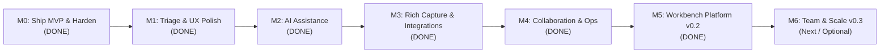

# Bug Tracking App — Readiness Assessment, Feature Plan & Timeline

> **Updated for `v0.2.0` — Workbench Platform** (2026-11-27)
> **Related Docs:** [Technical Knowledge Base](./KNOWLEDGE_BASE.md) · [User & Operations Wiki](./WIKI.md)

## 1. Is the Current Project Ready to Use?

### Verdict: **Yes — Feature-complete & production-ready for self-hosted internal use**

**What is built & verified:**
- **Code & build health:** `npx tsc --noEmit`, `npm run lint`, `npm test` (**9 files / 55 tests**), `npx prisma migrate status` (8 migrations), and `npm run build` all pass with **0 errors and 0 warnings**.
- **All original milestones (M0–M4) + Workbench Platform (`v0.2.0`) complete:**
  - Single-admin Auth.js v5 login with Next.js 16 [`proxy.ts`](../proxy.ts) + per-route `requireAdminSession()` defense-in-depth
  - Dockerized standalone deployment ([`Dockerfile`](../Dockerfile), [`docker-compose.yml`](../docker-compose.yml), `/api/health`)
  - Multi-project Linear/Jira-style Workbench: collapsible sidebar, Dark Mode + 5 Accent Themes, configurable layout width (`full`/`wide`/`narrow`), Page/Modal/Drawer Surface Engine (`?ticket=` URL sync + `J`/`K` stepping + `Cmd+K` + `C`)
  - Strict 6-state workflow (`open`, `todo`, `in_progress`, `blocked`, `resolved`, `closed`) with orthogonal SVG state diagram, `Urgent` priority, `Type → Priority → Status` triage ordering, sequential `PROJ-1` ticket keys, typed ticket links, Labels, Saved Views, Bulk Actions, and Kanban / Full / Fixed / Grid views
  - Tiptap v3 WYSIWYG Markdown editor for descriptions & notes, analytics dashboards (`recharts`), interactive `driver.js` tours, and type-to-confirm Danger Zone modals
  - AI Triage (cleanup, auto-triage, duplicate detection) + Repo-Aware Multimodal AI Investigate (root cause, fix plan, copyable coding prompt)
  - Multi-platform Git & External Trackers (GitHub, GitLab, Linear, Jira, Bitbucket) with two-way webhook sync + Built-in MCP Server (`/api/mcp` with 8 tools + `scripts/mcp-server.ts`)
  - Chrome Manifest V3 Extension `v0.2.0` with domain auto-lookup, viewport/DPR/failed-HTTP diagnostics, screenshot capture, and public/admin full-page editor launch
  - Complete Wiki ([`docs/WIKI.md`](./WIKI.md)) and in-app `/guide` hub

**Remaining pre-deployment checklist (operational, not code blockers):**
1. **Commit `v0.2.0` working tree** and tag release `v0.2.0` in Git when ready.
2. **Configure production secrets:** Set strong `AUTH_SECRET`, `ADMIN_PASSWORD`, `TRACKER_WEBHOOK_SECRET`, and optional AI/Tracker API keys in `.env`.
3. **Update extension production origin:** Replace `https://your-bug-tracker-domain.com/*` in [`extension/manifest.json`](../extension/manifest.json) and `DEFAULT_API_ORIGIN` in `popup.js`/`options.js` before distributing the extension.

---

## 2. Roadmap Overview

---

## 3. Completed Milestones (M0–M5)

| Milestone | Key Deliverables | Status |
| :--- | :--- | :--- |
| **M0 — Stabilize & Ship MVP** | Standalone `Dockerfile`, `docker-compose.yml`, `/api/health`, `requireAdminSession()` defense-in-depth, Vitest test suite, real `README.md` | **Done** (`v0.1.0`) |
| **M1 — Daily Triage & Admin UX** | Global inbox (`/feedback`), search/filter/sort/pagination, inline triage controls, source badges, project overview metrics | **Done** (`v0.1.0`) |
| **M2 — Phase 6: AI Assistance** | AI feedback cleanup & structuring, auto-triage (`type`/`priority`), duplicate detection, provider abstraction (`gemini`/`openai`/`heuristic`) | **Done** (`v0.1.0`) |
| **M3 — Rich Capture & Integrations** | Structured `pageUrl`/`browserInfo`, extension screenshot capture, outgoing project webhooks, GitHub Issue sync | **Done** (`v0.1.0`) |
| **M4 — Collaboration & Ops** | Internal admin notes, status history timeline, project-scoped API keys (`/api/v1/feedback`), DB-backed `RateLimitBucket`, CSV/JSON export & `db:backup` | **Done** (`v0.1.0`) |
| **M5 — Workbench Platform (`v0.2.0`)** | Collapsible Linear sidebar, Dark Mode + 5 Accent Themes, configurable width & Page/Modal/Drawer surfaces, strict 6-state workflow + linear SVG diagram, `Urgent` priority, `PROJ-1` keys, Linked Tickets, Labels, Saved Views, Bulk Actions, Kanban + 4 views, Tiptap v3 WYSIWYG Markdown, Global & Project Dashboards, Multi-platform Git & Trackers + two-way webhooks, Repo-aware AI Investigate, Built-in MCP Server (8 tools), `driver.js` tours, `/guide` + `docs/WIKI.md`, Type-to-Confirm Danger Zone, Extension `v0.2.0`, Next.js 16 `proxy.ts`, Prisma `prisma.config.ts` | **Done** (`v0.2.0`) |

---

## 4. Candidate Next Milestone — M6: Team, Storage & Observability (`v0.3.0`, Optional)

*Only tackle when real daily usage calls for these capabilities:*

| Feature | Details |
| :--- | :--- |
| **Multi-User Roles & Assignees** | Invite team members (`admin` / `triage` / `viewer`), assign tickets to users, and filter Saved Views by assignee |
| **Object Storage for Media** | Offload screenshots & file attachments from `screenshotDataUrl` in PostgreSQL to S3/R2/MinIO or local volume |
| **Playwright E2E Suite** | Automated browser smoke tests covering login, Kanban drag-and-drop, drawer stepping, Markdown editing, and public submit |
| **Email / Slack / Discord Digest & Replies** | Reporter email notifications when a ticket moves to `resolved` / `closed`, plus rich Slack/Discord block payloads |
| **SLA & Cycle / Sprint Planning** | Optional due dates, SLA breach indicators for `urgent` / `high` bugs, and lightweight sprint grouping |
